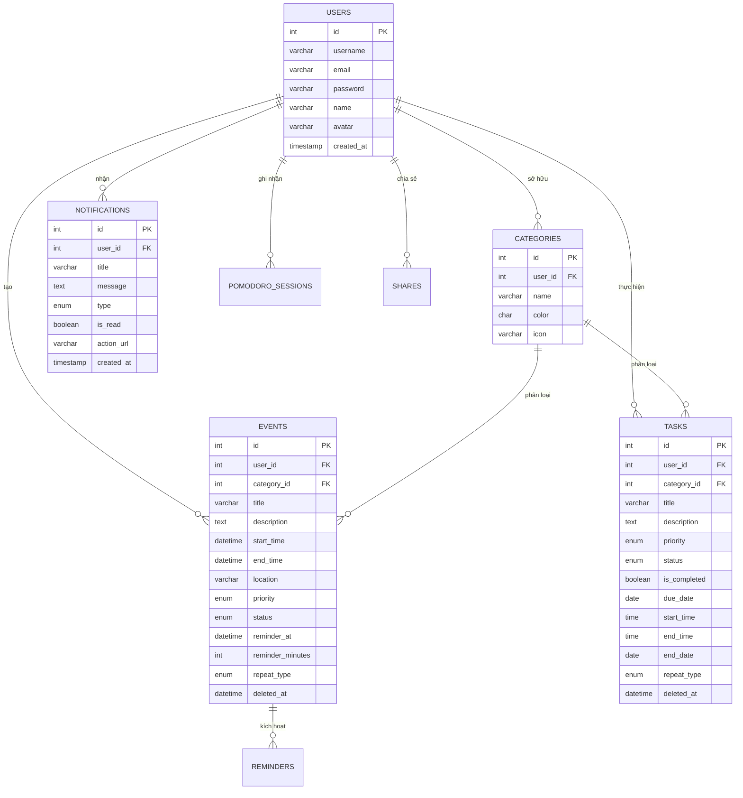

# TÀI LIỆU ĐẶC TẢ YÊU CẦU PHẦN MỀM (SRS)
## DỰ ÁN: PERSONAL CALENDAR — LỊCH CÁ NHÂN & QUẢN LÝ CÔNG VIỆC

> **Phiên bản:** 1.0.0  
> **Ngày lập:** 23/11/2026  
> **Trạng thái:** Chính thức (Đã đồng bộ giao diện và cơ sở dữ liệu)  
> **Kiến trúc:** PHP 8 MVC (Native PDO) + MySQL 8.0 + JavaScript (FullCalendar 6.1, Bootstrap 5.3)  
> **Tiêu chuẩn tài liệu:** Phù hợp định dạng chuẩn IEEE 830 (Software Requirements Specification)

---

## 1. GIỚI THIỆU (INTRODUCTION)

### 1.1. Mục đích
Tài liệu Đặc tả Yêu cầu Phần mềm (SRS) này mô tả toàn diện, chi tiết các yêu cầu chức năng, yêu cầu phi chức năng, kiến trúc cơ sở dữ liệu và thiết kế giao diện của hệ thống **Personal Calendar**. Tài liệu đóng vai trò là căn cứ kỹ thuật chính xác cho quá trình phát triển, kiểm thử, nghiệm thu và chuyển giao sản phẩm.

### 1.2. Phạm vi sản phẩm (Scope)
**Personal Calendar** là ứng dụng web quản lý thời gian và năng suất cá nhân (Personal Productivity System) tinh gọn, tốc độ cao, hỗ trợ chạy mượt mà trên cả trình duyệt máy tính và thiết bị di động (Mobile-First). Hệ thống tích hợp hai giải pháp cốt lõi:
1. **Quản lý Lịch trình (Calendar & Events):** Lên kế hoạch sự kiện, cuộc hẹn theo Ngày / Tuần / Tháng với tính năng kéo thả (Drag & Drop) và co giãn thời lượng trực quan.
2. **Quản lý Đầu việc (Tasks & Action Items):** Theo dõi tiến độ công việc, hạn chót (Deadline), cảnh báo việc quá hạn và phân chia mức độ ưu tiên.

Ngoài ra, hệ thống tích hợp các tiện ích: Đồng hồ tập trung Pomodoro, Chuông thông báo thông minh (Web Notification), Chế độ giao diện Sáng/Tối (Light/Dark Mode) và bộ khởi chạy tự động Zero-Config Dev Runner.

### 1.3. Đối tượng sử dụng tài liệu
* **Đội ngũ Phát triển (Developers):** Căn cứ cài đặt logic xử lý, controller, model và frontend UI.
* **Đội ngũ Kiểm thử (QA/Testers):** Căn cứ viết Test Cases, kịch bản kiểm thử luồng (E2E) và kiểm thử biên.
* **Người dùng / Khách hàng / Hội đồng đánh giá:** Hiểu rõ khả năng, giới hạn và giá trị thực tế của ứng dụng.

### 1.4. Thuật ngữ & Viết tắt
| Thuật ngữ | Diễn giải |
| :--- | :--- |
| **SRS** | Software Requirements Specification — Tài liệu đặc tả yêu cầu phần mềm |
| **MVC** | Model - View - Controller — Mô hình kiến trúc phần mềm |
| **PDO** | PHP Data Objects — Lớp giao tiếp CSDL an toàn trong PHP với Prepared Statements |
| **CSRF** | Cross-Site Request Forgery — Lỗ hổng giả mạo yêu cầu từ phía người dùng |
| **IDOR** | Insecure Direct Object References — Lỗ hổng tham chiếu trực tiếp đối tượng không an toàn |
| **Optimistic UI** | Kỹ thuật cập nhật giao diện ngay lập tức (0ms) trước khi có phản hồi từ máy chủ |
| **Soft Delete** | Cơ chế xóa mềm (đánh dấu `deleted_at`) chuyển vào Thùng rác thay vì xóa vĩnh viễn khỏi DB |

---

## 2. MÔ TẢ TỔNG QUAN HỆ THỐNG (OVERALL DESCRIPTION)

### 2.1. Kiến trúc tổng thể
* **Backend:** PHP 8.0+ thuần chạy theo mô hình MVC, định tuyến qua `index.php`.
* **Database:** MySQL 8.0 / MariaDB (utf8mb4_unicode_ci) với quan hệ khóa ngoại (Foreign Keys) và chỉ mục tối ưu (Indexes).
* **Frontend:** HTML5, CSS3, JavaScript ES6+, Bootstrap 5.3, FullCalendar 6.1, FontAwesome 6.5, SweetAlert2, Toast custom.
* **Tự động hóa:** Runner Node.js (`scripts/dev.mjs`) tự động tìm và bật MySQL ngầm, tự động chạy migration tạo DB (`scripts/bootstrap-db.php`) và bật PHP built-in server qua 1 lệnh `npm run dev`.

### 2.2. Tác nhân hệ thống (User Personas)
* **Khách vãng lai (Guest):** Chỉ có quyền truy cập trang Đăng nhập (`login`) và Đăng ký (`register`).
* **Người dùng đã xác thực (User):** Sở hữu toàn quyền trên không gian làm việc của chính mình (Lịch, Tasks, Thông báo, Cài đặt cá nhân, Thùng rác). Dữ liệu được cô lập hoàn toàn giữa các tài khoản qua `user_id`.

### 2.3. Môi trường vận hành
* **Phía máy chủ:** Windows, macOS, Linux có cài đặt PHP 8.0+ và MySQL / MariaDB (hỗ trợ sẵn các bộ phần mềm Laragon, XAMPP, WAMP, MAMP hoặc Docker).
* **Phía người dùng:** Mọi trình duyệt web hiện đại (Google Chrome, Microsoft Edge, Mozilla Firefox, Safari) trên Desktop, Tablet và Smartphone (chuẩn responsive tối thiểu 360px).

---

## 3. YÊU CẦU CHỨC NĂNG CHI TIẾT (FUNCTIONAL REQUIREMENTS)

### 3.1. Phân hệ Xác thực & Bảo mật (FR1: Authentication & Security)
* **FR1.1 — Đăng ký:** Cho phép người dùng mới tạo tài khoản gồm Họ tên, Email, Tên đăng nhập và Mật khẩu (mã hóa chuẩn `BCRYPT`). Kiểm tra tính duy nhất của Email và Tên đăng nhập.
* **FR1.2 — Đăng nhập:** Xác thực người dùng bằng Tên đăng nhập/Email + Mật khẩu. Khi thành công, tự động cấp phiên làm việc an toàn (`session_regenerate_id(true)`) chống tấn công Session Fixation.
* **FR1.3 — Đăng xuất:** Hủy phiên làm việc (`session_destroy()`), xóa cookie phiên và chuyển hướng về trang Đăng nhập.
* **FR1.4 — Bảo vệ CSRF:** Toàn bộ form nhập liệu và request AJAX POST/PUT/DELETE bắt buộc phải có mã xác thực CSRF Token hợp lệ.
* **FR1.5 — Đổi mật khẩu:** Cho phép người dùng đổi mật khẩu trong trang Cài đặt; yêu cầu xác nhận đúng mật khẩu hiện tại và kiểm tra độ dài mật khẩu mới (tối thiểu 6 ký tự).
* **FR1.6 — Chống lỗ hổng IDOR:** Mọi thao tác truy vấn, cập nhật, xóa sự kiện, công việc, danh mục đều bắt buộc đối chiếu với `user_id` của phiên đăng nhập hiện hành.

### 3.2. Module "Hôm nay" (FR2: Dashboard / Today)
* **FR2.1 — Tóm tắt tiến độ ngày:** Hiển thị số lượng đầu việc đã hoàn thành trên tổng số việc hôm nay (ví dụ: `3/5 việc`), thanh tiến độ trực quan dạng phần trăm.
* **FR2.2 — Danh sách sự kiện & công việc trong ngày:** Liệt kê các mục có lịch hoặc hạn chót rơi vào ngày hôm nay, sắp xếp theo thứ tự mốc giờ tăng dần.
* **FR2.3 — Check-in hoàn thành nhanh:** Cho phép người dùng bấm vào nút tròn (checkbox) bên cạnh công việc để đánh dấu hoàn thành ngay tại chỗ mà không cần chuyển trang.
* **FR2.4 — Phân loại trực quan:** Hiển thị thẻ màu danh mục, khung giờ (ví dụ `08:00 – 09:00`), mức ưu tiên, địa điểm/phòng họp và nhãn trạng thái ("Sắp diễn ra", "Đang diễn ra", "Đã xong").
* **FR2.5 — Tiện ích Pomodoro mini:** Cho phép khởi động chu kỳ bấm giờ tập trung 25 phút làm việc / 5 phút nghỉ ngay trên trang Dashboard.

### 3.3. Module "Lịch" (FR3: Calendar Management)
* **FR3.1 — Đa chế độ xem (Multi-Views):**
  * *Chế độ Tháng (Month View):* Hiển thị lưới lịch 30/31 ngày, gom sự kiện tràn qua nút "Xem thêm (+X)".
  * *Chế độ Tuần (Week View):* Hiển thị cột 7 ngày với các khung giờ từ `00:00` đến `23:00`.
  * *Chế độ Ngày (Day View):* Hiển thị chi tiết từng khung giờ 30 phút trong ngày.
* **FR3.2 — Kéo thả đổi ngày (Drag & Drop):** Giữ chuột kéo sự kiện sang ô ngày khác; hệ thống cập nhật ngày mới và giữ nguyên khung giờ.
* **FR3.3 — Kéo thả đổi giờ & co giãn thời lượng (Resize):** Trong view Tuần/Ngày, kéo sự kiện lên xuống để đổi giờ; kéo mép dưới để tăng/giảm thời lượng cuộc họp.
* **FR3.4 — Kéo thả sắp xếp cùng ngày (Same-day Reordering):** Cho phép kéo thả thay đổi thứ tự sự kiện ngay trong popup "Xem thêm" hoặc ô ngày; hệ thống tự tính toán lại giờ bắt đầu/kết thúc tương ứng theo cơ chế Optimistic UI.
* **FR3.5 — Quét chọn tạo nhanh (Select to Add):** Giữ chuột quét dải giờ trên lưới lịch để mở form tạo sự kiện với ngày giờ được điền tự động 100%.
* **FR3.6 — Bộ lọc danh mục:** Bật/tắt lọc sự kiện theo từng danh mục công việc (Họp, Thiết kế, Gia đình, Học tập,...).

### 3.4. Form Thêm / Chỉnh sửa Lịch trình (FR3-Form: Event Modal)
* **FR3-F.1 — Nhập tiêu đề:** Bắt buộc nhập, tối đa 180 ký tự.
* **FR3-F.2 — Tùy chọn sự kiện nhiều ngày:** Mặc định ẩn ô "Đến ngày"; chỉ mở rộng khi người dùng tích chọn "Sự kiện nhiều ngày", tự kiểm tra ngày kết thúc $\ge$ ngày bắt đầu.
* **FR3-F.3 — Tùy chọn cả ngày / chưa gắn giờ:** Tự động vô hiệu hóa 2 ô giờ và gán thời gian từ `00:00:00` đến `23:59:00`.
* **FR3-F.4 — Tần suất lặp lại:** Hỗ trợ: Không lặp, Hằng ngày, Hằng tuần, Hằng tháng.
* **FR3-F.5 — Chọn danh mục & Địa điểm:** Gắn danh mục màu sắc và địa điểm họp/link online.
* **FR3-F.6 — Hẹn giờ nhắc nhở thông minh:** Hỗ trợ chọn nhắc trước: Đúng giờ, 5p, 10p, 15p, 30p, 1h, 1 ngày. Tự động tính toán mốc giờ thực và hiển thị dòng xem trước: *"Nhắc lúc: HH:mm, dd/MM"*.

### 3.5. Module "Tasks" (FR4: Tasks & Action Items Management)
* **FR4.1 — Thống kê & Thanh tiến độ:** Hiển thị tổng số việc, số việc đã xong, tỷ lệ %, số việc chờ xử lý, số việc quá hạn và số việc khẩn cấp.
* **FR4.2 — Dải cảnh báo quá hạn (Overdue Banner):** Tự động phát hiện và ghim thông báo đỏ ở đầu danh sách nếu có công việc quá hạn chưa hoàn thành.
* **FR4.3 — Tabs phân loại trạng thái:** 4 tab chuyển đổi nhanh: *Tất cả*, *Chưa xong*, *Đã xong*, *Quá hạn*.
* **FR4.4 — Bộ lọc & Sắp xếp chuyên sâu:** Lọc theo mức ưu tiên (Khẩn cấp, Cao, Trung bình, Thấp), lọc theo danh mục, sắp xếp theo Hạn chót (Gần/Xa), Mức ưu tiên (Cao/Thấp), Ngày tạo (Mới/Cũ).
* **FR4.5 — Thao tác nhanh:** Tích chọn checkbox hoàn thành trực tiếp trên từng dòng, sửa nội dung hoặc xóa chuyển vào thùng rác.

### 3.6. Module "Sắp tới" (FR5: Upcoming Roadmap)
* **FR5.1 — Gom nhóm theo dòng thời gian:** Tự động phân chia sự kiện và công việc theo từng ngày kế tiếp (*Ngày mai, Thứ Tư, Thứ Năm,...*).
* **FR5.2 — Badge số lượng:** Hiển thị số lượng mục cần làm trong từng ngày.
* **FR5.3 — Nút thêm nhanh theo ngày:** Nút `+` tại tiêu đề mỗi ngày cho phép mở popup tạo việc mới với ngày được chọn sẵn.

### 3.7. Module "Thùng rác" (FR6: Trash & Soft-Delete)
* **FR6.1 — Cơ chế xóa mềm:** Khi xóa công việc hoặc sự kiện, dữ liệu chỉ cập nhật cột `deleted_at = NOW()` và ẩn khỏi các màn hình chính.
* **FR6.2 — Danh sách thùng rác:** Hiển thị rõ danh sách các mục đã xóa, phân loại nhãn (Task hay Event) và mốc thời gian xóa.
* **FR6.3 — Khôi phục (Restore):** Cho phép khôi phục mục đã xóa trở lại nguyên trạng.
* **FR6.4 — Xóa vĩnh viễn (Force Delete):** Xóa triệt để bản ghi khỏi cơ sở dữ liệu.
* **FR6.5 — Dọn sạch thùng rác (Empty Trash):** Một nút xóa vĩnh viễn toàn bộ các bản ghi đang nằm trong thùng rác.

### 3.8. Tiện ích Header & Cài đặt (FR7: Global Features & Settings)
* **FR7.1 — Tìm kiếm nhanh toàn hệ thống (`Ctrl + K`):** Ô tìm kiếm live search gợi ý tức thì cả lịch trình lẫn đầu việc kèm giờ, danh mục và link điều hướng.
* **FR7.2 — Chuyển đổi Dark / Light Theme:** Nút chuyển đổi giao diện sáng/tối với 1 click, lưu cấu hình vào `localStorage`.
* **FR7.3 — Trung tâm Thông báo & Web Push:** Dropdown thông báo các việc sắp diễn ra, việc quá hạn. Tích hợp âm thanh chuông báo và Browser Notification API khi đến mốc nhắc nhở.
* **FR7.4 — Cài đặt tài khoản:** Cập nhật họ tên, cấu hình tùy chọn âm thanh, toast nổi và đếm giờ Pomodoro.

---

## 4. YÊU CẦU PHI CHỨC NĂNG (NON-FUNCTIONAL REQUIREMENTS - NFR)

### 4.1. Hiệu năng & Tốc độ (Performance)
* Thời gian phản hồi của các API JSON (`api-events`, `api-tasks-list`, `api-event-time`) phải đạt dưới **150ms** trên môi trường tiêu chuẩn.
* Thao tác kéo thả và tích chọn hoàn thành công việc áp dụng cơ chế **Optimistic UI**, phản hồi trên giao diện người dùng đạt độ trễ **0ms**.

### 4.2. An toàn & Bảo mật (Security)
* **Phòng chống SQL Injection:** Sử dụng 100% PDO Prepared Statements với tham số ràng buộc kiểu dữ liệu rõ ràng.
* **Phòng chống XSS:** Toàn bộ dữ liệu hiển thị từ người dùng đều được lọc qua `htmlspecialchars(..., ENT_QUOTES, 'UTF-8')`.
* **Phòng chống CSRF:** Token ngẫu nhiên bảo mật lưu trong session và xác thực cho mọi thao tác ghi dữ liệu.
* **Mật khẩu an toàn:** Mã hóa bằng thuật toán `password_hash(..., PASSWORD_BCRYPT)`.
* **Kiểm soát quyền sở hữu (IDOR Defense):** Xác thực nghiêm ngặt quyền sở hữu `user_id` trước khi thực thi bất kỳ truy vấn sửa/xóa nào.

### 4.3. Khả năng tương thích & Giao diện (Usability & Compatibility)
* Thiết kế chuẩn theo định hướng **Mobile-First Responsive**, hỗ trợ mượt mà từ màn hình nhỏ nhất (chiều rộng $\ge 360px$) cho tới màn hình máy tính 4K.
* Hỗ trợ đầy đủ hai chủ đề màu sắc: **Chế độ Sáng (Light Mode)** trang nhã và **Chế độ Tối (Dark Mode)** độ tương phản cao, dịu mắt ban đêm.

### 4.4. Độ tin cậy & Tự phục hồi (Reliability)
* **Cơ chế Revert UI:** Khi một thao tác kéo thả lịch hoặc đổi trạng thái bị gián đoạn do lỗi mạng hoặc máy chủ, giao diện tự động trả sự kiện về vị trí ban đầu và xuất Toast báo lỗi.
* **Watchdog tự động hóa:** Bộ script Node.js theo dõi và tự động bật lại MySQL nếu tiến trình bị dừng đột ngột.

---

## 5. THIẾT KẾ CƠ SỞ DỮ LIỆU (DATABASE SPECIFICATION)

Cơ sở dữ liệu `personal_calendar` được xây dựng với bảng mã `utf8mb4_unicode_ci`.

### Chi tiết các bảng chính:
1. **`users`:** Lưu thông tin tài khoản đăng nhập, họ tên, email và mật khẩu mã hóa BCRYPT.
2. **`categories`:** Lưu danh mục công việc/sự kiện (Họp, Cá nhân, Thiết kế...) gắn liền với mã màu Hex (`#5b52e0`, `#38bdf8`...) riêng của từng user.
3. **`events`:** Lưu lịch trình, khung giờ bắt đầu (`start_time`), kết thúc (`end_time`), mốc nhắc nhở (`reminder_at`), lặp lại và cột xóa mềm (`deleted_at`).
4. **`tasks`:** Lưu các đầu việc cần làm, hạn chót (`due_date`), trạng thái (`is_completed`), mức ưu tiên (`urgent`, `high`, `medium`, `low`) và cột xóa mềm (`deleted_at`).
5. **`notifications`:** Lưu lịch sử các thông báo nhắc nhở, cảnh báo quá hạn, link hành động (`action_url`) và trạng thái đọc (`is_read`).
6. **`pomodoro_sessions`:** Lưu các phiên tập trung làm việc 25 phút đã hoàn thành trong ngày.
7. **`reminders`:** Theo dõi trạng thái đã gửi/chưa gửi (`is_sent`) của chuông nhắc lịch.

---

## 6. MA TRẬN ĐẶC TẢ USE CASE & ROUTING

| Mã Use Case | Tên chức năng | Route URL / Request | Controller xử lý | Quyền truy cập |
| :--- | :--- | :--- | :--- | :--- |
| **UC-01** | Đăng nhập tài khoản | `?page=login` / `login-post` | `AuthController@login` | Khách (Guest) |
| **UC-02** | Đăng ký tài khoản | `?page=register` / `register-post` | `AuthController@register` | Khách (Guest) |
| **UC-03** | Xem Dashboard Hôm nay | `?page=dashboard` | `DashboardController@index` | Đã đăng nhập |
| **UC-04** | Xem Lịch tương tác | `?page=calendar` | `EventController@index` | Đã đăng nhập |
| **UC-05** | API Lấy dữ liệu sự kiện | `?page=api-events` | `EventController@apiEvents` | Đã đăng nhập |
| **UC-06** | API Thêm/Sửa lịch trình | `?page=api-event-save` (POST) | `EventController@save` | Đã đăng nhập |
| **UC-07** | API Kéo thả đổi giờ lịch | `?page=api-event-time` (POST) | `EventController@updateTime` | Đã đăng nhập |
| **UC-08** | API Xóa mềm lịch trình | `?page=api-event-delete` (POST) | `EventController@delete` | Đã đăng nhập |
| **UC-09** | Quản lý danh sách Tasks | `?page=tasks` | `TaskController@index` | Đã đăng nhập |
| **UC-10** | API Thêm/Sửa Task | `?page=api-task-save` (POST) | `TaskController@save` | Đã đăng nhập |
| **UC-11** | API Đổi trạng thái Task | `?page=api-task-status` (POST) | `TaskController@updateStatus` | Đã đăng nhập |
| **UC-12** | Xem lộ trình Sắp tới | `?page=upcoming` | `TaskController@upcomingData` | Đã đăng nhập |
| **UC-13** | Quản lý Thùng rác | `?page=trash` | `TaskController@trashData` | Đã đăng nhập |
| **UC-14** | API Khôi phục từ Thùng rác | `?page=api-task-restore` (POST) | `TaskController@restore` | Đã đăng nhập |
| **UC-15** | API Dọn sạch Thùng rác | `?page=api-trash-empty` (POST) | `TaskController@emptyTrash` | Đã đăng nhập |
| **UC-16** | Quét nhắc nhở thông minh | `?page=api-reminders-check` | `NotificationController@checkReminders` | Đã đăng nhập |
| **UC-17** | Tìm kiếm nhanh | `?page=api-search` | `EventController@apiSearch` | Đã đăng nhập |
| **UC-18** | Cài đặt & Đổi mật khẩu | `?page=settings` / `api-change-password` | `AuthController@apiChangePassword` | Đã đăng nhập |
